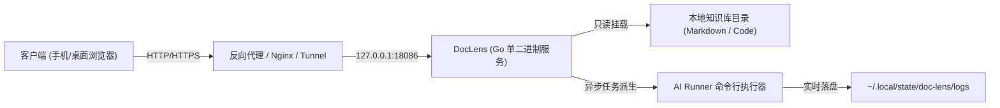

# DocLens 🔍

> **现代极简、高性能的轻量级技术文档与 Markdown 知识库系统**  
> 单二进制交付 · 零外部依赖 · 毫秒级加载 · 原生三栏双端响应 · 异步 AI 创作引擎

[](https://golang.org)
[](LICENSE)
[](#)
[](#)

---

## 🌟 核心设计理念

传统的开源知识库工具（如 Wiki.js、GitBook、Outline 等）往往依赖庞大的 Node.js 运行时、外部数据库（PostgreSQL/MySQL）和复杂的前端构建管线。

**DocLens 走了一条极致克制的极简路线**：
- **纯原生 Go 后端**：负责目录树索引、安全路径解析、异步任务队列与安全鉴权。
- **纯原生前端 SPA**：坚持零 npm 依赖，所有静态资源在编译阶段通过 `//go:embed` 打包进单个独立二进制文件。
- **直读本地目录**：不依赖任何数据库，直接读取本地 Markdown/HTML/代码文件，目录结构即知识库结构。

---

## ✨ 核心特性

### 1. 🚀 极致性能与单二进制交付
- **内存常驻仅 ~2MB**，毫秒级极速冷启动。
- 单个二进制文件即可独立部署，自带所有前端样式、图标与脚本，部署迁移只需复制一个文件。

### 2. 📖 媲美 Notion / GitHub 的阅读体验
- **桌面端三栏高效布局**：可折叠/拖拽侧边栏、中栏沉浸正文排版、右栏常驻滚动跟随高亮大纲（ScrollSpy TOC）。
- **全要素渲染支持**：
  - 📊 **Mermaid 架构图**：原生矢量渲染，支持平滑缩放与一键全屏查看。
  - 💡 **GitHub 风格 Alerts**：支持 `[!NOTE]`, `[!TIP]`, `[!IMPORTANT]`, `[!WARNING]`, `[!CAUTION]`。
  - 💻 **代码与沙箱**：Prism 高亮带一键复制代码；`.html` 文件支持安全沙箱（iframe sandbox）无缝预览与源码切换。
  - 📐 **KaTeX 公式**：支持数学公式快速排版。

### 3. 📱 手机触控端深度打磨
- **抽屉式大纲导轨**：快速检索与模糊快搜。
- **智能双悬浮球（FAB Stack）**：
  - ✏️ **AI 创作笔**（炫彩紫）与 📖 **目录大纲**（科技蓝）组合悬浮球。
  - **自由拖拽 + 左右贴边吸附**（Snap-to-Edge）：松手自动靠边，并带弹性阻尼微交互。
  - **位置持久化记忆**：屏幕旋转或下次打开页面，自动恢复到上次停放位置。
  - **阅读防遮挡微交互**：向下滚动阅读正文时自动半透明微缩小，向上滑动或停顿时恢复。

### 4. 🤖 异步离线 AI 写作与文档深度解剖
- 前端可直接针对当前章节派发【AI 扩写创作】或【AI 深度解剖提炼】。
- **脱壳持续运行**：任务派生后与网页会话彻底解耦，手机锁屏或关闭浏览器，后台依然稳步执行。
- **任务中心与实时日志**：内置单并发排队锁，杜绝击穿 API 配额；随时重开网页即可实时滚屏查看执行日志。

### 5. 🔗 专属安全免密分享
- 支持为单篇文档生成对外只读分享链接（`/s/:id`）。
- 支持设置有效期限（1小时/1天/7天/永久）与独立访问提取码。
- **分享模式权限隔离**：访客进入后，后台写操作、AI 创作笔、全库目录与敏感操作均自动隐藏剥离，保证私密数据安全。

### 6. 🛡️ 纵深防御安全基线
- **凭据加盐哈希**：支持 bcrypt 密码哈希，内置防暴力破解（失败频次锁定）。
- **超长免密体验**：签发 180 天长效安全 HttpOnly Cookie。
- **路径遍历防御**：内置严格的路径清理与沙箱边界校验，杜绝 `../` 越界读取漏洞。

---

## 🏗️ 架构拓扑



---

## 🚀 快速上手 (Quick Start)

### 1. 源码编译

```bash
# 克隆仓库
git clone https://github.com/zongqir/doc-lens.git
cd doc-lens

# 编译为单二进制
go build -o bin/doc-lens .
```

### 2. 准备配置文件

```bash
# 从模板生成配置文件
cp config.example.yaml config.yaml

# 编辑 config.yaml，设置您的文档目录与端口
vim config.yaml
```

### 3. 启动服务

```bash
./bin/doc-lens
# 服务默认运行在 http://0.0.0.0:18086
# 初始登录密码默认为 admin888 (可在 config.yaml 中自定义)
```

---

## ⚙️ 配置文件说明 (`config.yaml`)

```yaml
port: 18086
host: "0.0.0.0"

auth:
  initial_password: "admin888"   # 首次登录密码，启动后自动转换为 bcrypt 加密哈希
  session_secret: ""             # 留空时首次启动自动生成 32 字节随机高熵密钥
  session_days: 180              # 登录 Cookie 保持天数

repositories:
  - id: docs
    name: "技术知识库 (Docs)"
    path: "./docs"               # 本地 Markdown/代码仓库路径
    route_prefix: "/docs"        # Web 路由前缀
    description: "核心架构与技术文档"
    writable: true               # 是否允许 AI 扩写回写
    ignore_dirs:                 # 忽略扫描的目录
      - ".git"
      - "node_modules"

ai:
  runner_cmd: "dagu-ai"          # 外部 AI 命令行工具
  max_queue: 10                  # 最大并发排队数
```

---

## 🐧 生产环境 Systemd 后台托管示例

创建用户级服务配置文件 `~/.config/systemd/user/doc-lens.service`：

```ini
[Unit]
Description=DocLens Knowledge Base Service
After=network.target

[Service]
Type=simple
WorkingDirectory=/path/to/doc-lens
ExecStart=/path/to/doc-lens/bin/doc-lens -config /path/to/doc-lens/config.yaml
Restart=on-failure
RestartSec=5

[Install]
WantedBy=default.target
```

启停控制命令：
```bash
systemctl --user daemon-reload
systemctl --user enable --now doc-lens
systemctl --user status doc-lens
```

---

## 📄 开源许可证

本项目基于 [MIT License](LICENSE) 协议开源。
