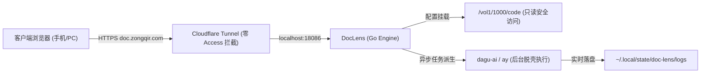

# DocLens - 现代极简代码与 Markdown 知识库投影器

专门用于替代传统通用网盘弹窗，提供**专业技术文档级阅读体验**与**后台异步 AI 创作**的原生 Go 服务。

---

## 核心特性

1. **单二进制零依赖交付**：
   - 基于 Go 1.25 构建，前端 HTML/CSS/JS/Mermaid/Prism 完整打包嵌入（`//go:embed`）。
   - 内存占用极低（常驻仅 ~2MB），启动耗时毫秒级。
2. **多仓库动态挂载与配置驱动**：
   - 通过 `config.yaml` 灵活定义多个仓库映射。
   - 挂载根目录 `/vol1/1000/code` 并绑定前缀 `/files`，**100% 原生承接既有直达链接**。
3. **移动端与桌面端双端极致体验**：
   - **手机端**：汉堡抽屉式仓库树（支持模糊快搜）、右下角悬浮大纲球（FAB）弹出目录、Mermaid 架构图平滑滚动与全屏缩放。
   - **电脑端**：经典高效三栏布局、可拖拽侧边栏、中栏 Notion/GitHub 级排版、右栏常驻滚动跟随高亮大纲（ScrollSpy TOC）。
   - **渲染全要素**：原生 Mermaid 矢量渲染、GitHub Alerts 卡片（`[!NOTE]` 等）、代码高亮与一键复制、KaTeX 数学公式。
4. **HTML 沙箱与纯文本模式**：
   - `.html` 文件支持安全沙箱（iframe sandbox）无缝预览与源码切换。
   - `.py`, `.sh`, `.json`, `.yaml` 等支持带行号的高亮阅读。
5. **AI 异步任务引擎（离线后台脱壳持续运行）**：
   - 前端可发起【AI 写作】或【AI 深度解剖当前文章】。
   - 任务派生后与网页会话解耦，**手机锁屏或关闭浏览器后 NAS 后台依然持续执行**。
   - 内置单任务并发排队锁，杜绝击穿 API 配额；随时重开网页进入【任务中心】查看实时滚动日志并直达生成文章。
6. **长效免密鉴权（彻底摆脱 Cloudflare Access 延迟）**：
   - 密码加盐哈希（Argon2id/bcrypt），防暴力破解（15分钟锁限制）。
   - 发放 180 天长效安全 HttpOnly Cookie，输入一次密码后数月内秒开。

---

## 运行与运维

- **配置文件**：`config.yaml`
- **监听端口**：`18086`
- **Systemd 用户服务**：`systemctl --user status doc-lens.service`
- **日志与状态存储**：`~/.local/state/doc-lens/`

---

## 架构拓扑

